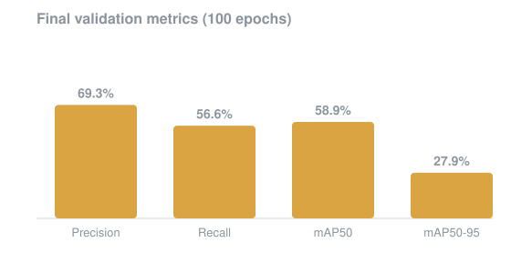
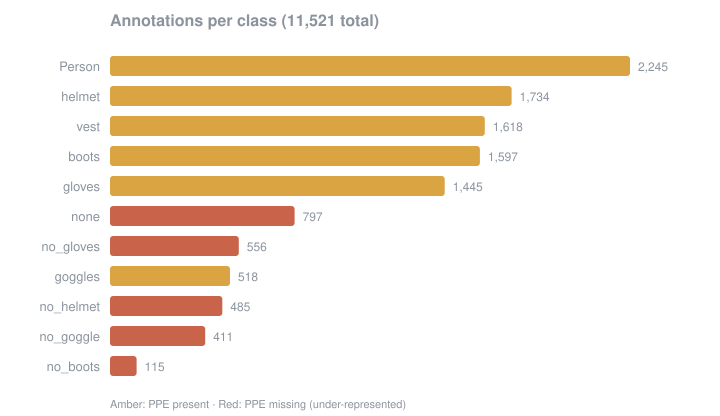

# 🦺 PPE Detection with YOLO26

Object-detection model that identifies **personal protective equipment** on construction sites (helmets, vests, gloves, boots, goggles) and also flags **missing PPE** (no_helmet, no_gloves, no_boots…).

Coursework for the **Diplomatura en Inteligencia Artificial – UTN FRBA** (Computer Vision module). Team project (2 people), October 2026.



## Results

| Metric | Value | What it means |
|---|---|---|
| Precision | **69.3%** | Of everything the model detected, 69.3% was correct |
| Recall | **56.6%** | Of everything that should have been detected, the model found 56.6% |
| mAP50 | **58.9%** | Average precision with a 50% box-overlap requirement |
| mAP50-95 | **27.9%** | Average precision over IoU thresholds 0.50 → 0.95 (tight boxes) |

**How to read them together**

- **Precision > recall** → a conservative model: when it fires it is usually right, but it misses a significant share of objects.
- **mAP50 (58.9%) vs mAP50-95 (27.9%)** → the model gets the *class* right much more often than it draws a *tight box*. Localization, not classification, is the weak point.

## Setup

| | |
|---|---|
| Platform | Ultralytics Platform (cloud training) |
| Base model | YOLO26s (pretrained) |
| Epochs | 100, default hyperparameters |
| Dataset | Construction PPE: 1,416 labeled images, 11,521 annotations, 11 classes |
| Split | 1,132 train / 143 val / 141 test |

## Dataset



The dataset is **imbalanced**. Person, helmet and vest dominate, while the "missing PPE" classes are under-represented. `no_boots` has only 115 annotations in 36 images. The model therefore detects *a worker wearing a helmet* far more reliably than *a worker without boots*, which is exactly the case a real safety system cares about most.

## Training behaviour

mAP50-95 climbed fast in the first ~15 epochs (≈0.05 → 0.20), reached ≈0.25 around epoch 25 and then plateaued between 0.25 and 0.28 until the end. The model **converged around epoch 25–30**. Training for many more epochs would not have helped and would risk overfitting.

## Inference tests

Tested with new images of workers on site, outside the dataset.

| Test | Scene | Detections (confidence) | Takeaway |
|---|---|---|---|
| 1 | One worker, 640×426 | vest 90.3%, helmet 89.5%, Person 88.4%, goggles 69.3% | All correct; best-represented classes score highest |
| 2 | Two workers | Person 86.4%, helmet 80.6% / 54.5%, vest 77.6%, gloves 46.7% / 33.6% | Confidence drops for the distant worker and for small objects |
| 3 | Worker on scaffolding, 254×382 | Person 88.8%, helmet 85.7%, vest 76.5% | **Missed the gloves** and the vest box was too loose (localization error) |

On CPU, inference took roughly 0.2–1 s per image, which is too slow for live video without optimization.

## Limitations

- **Small objects** (gloves, goggles) get low confidence or are missed, especially in low-resolution images.
- **Class imbalance**: the "missing PPE" alerts are the least represented classes.
- **Domain bias**: images are mostly daylight, outdoor construction sites. Performance would drop in other settings (e.g. underground mining: artificial light, dust, different equipment).
- With **56.6% recall**, this model should not be the sole safety control. A false negative means an unprotected worker reported as safe.

## Next steps

- Larger input size or image tiling to help with small objects
- Rebalance / augment the missing-PPE classes
- Fine-tune on images from the actual deployment site
- Export to **TensorRT** for real-time inference on NVIDIA edge hardware (or **ONNX** if the target hardware is unknown)

## Try it locally

```bash
pip install ultralytics
yolo detect train data=construction-ppe.yaml model=yolo26s.pt epochs=100 imgsz=640
```

> Note: the Construction-PPE dataset bundled with the Ultralytics package uses a slightly different class list and split than the platform version used here, so the numbers will not match exactly.

## Credits

- Dataset: [Ultralytics Construction-PPE](https://docs.ultralytics.com/datasets/detect/construction-ppe) (CC BY 4.0)
- Model: [Ultralytics YOLO26](https://docs.ultralytics.com/)
- Course: Diplomatura en Inteligencia Artificial, Centro de e-Learning UTN FRBA
